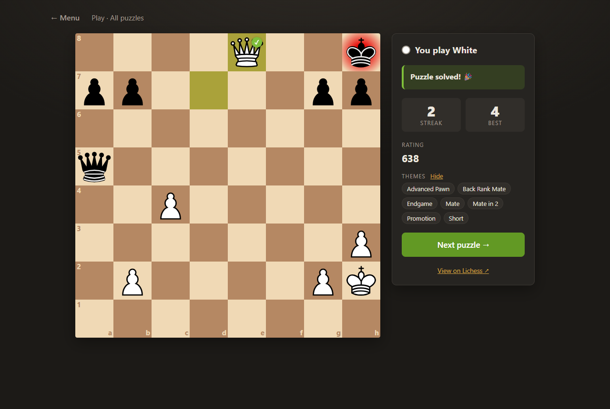
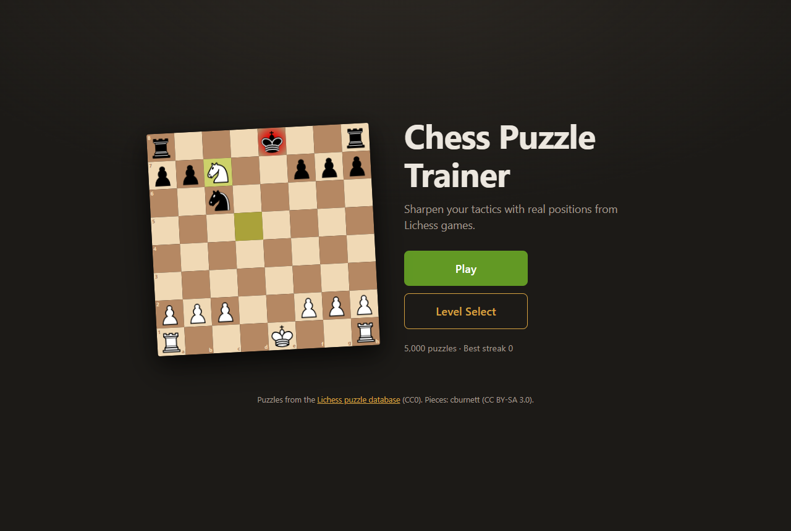
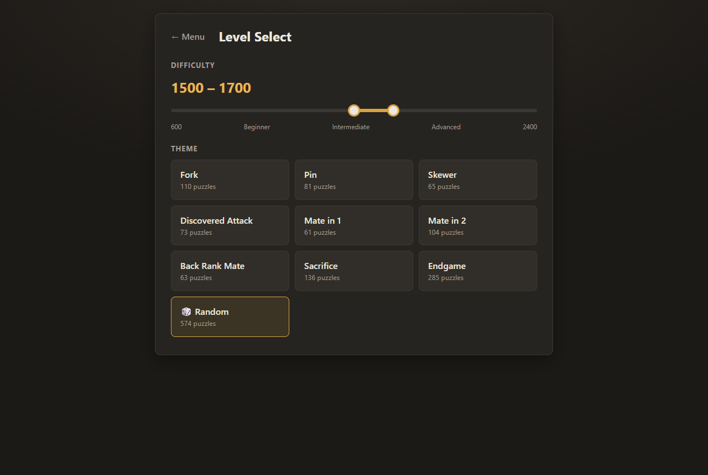

# Chess Puzzle Trainer

A static web app for training chess tactics, using 5,000 real puzzles from the
[Lichess open puzzle database](https://database.lichess.org/#puzzles).
It has no framework, no build step and no server: plain HTML, CSS and JavaScript,
hosted on GitHub Pages.

**Live demo: https://jacques-marquet.github.io/chess-puzzle-trainer/**



## Features

- **Play**: an endless stream of random puzzles at every difficulty and theme.
- **Level Select**: a two-handle rating slider (600–2400) plus theme buttons
  (Fork, Pin, Skewer, Discovered Attack, Mate in 1, Mate in 2, Back Rank Mate,
  Sacrifice, Endgame), or **Random**, which uses the rating range only.
  Each button shows how many puzzles match.
- **Puzzle screen**
  - The opponent's first move is animated, then you move.
  - The board is oriented from your side: if you play Black, Black is at the bottom.
  - Move by **drag-and-drop** or **click-to-move**. Legal moves are shown as dots.
  - A green ✓ means correct and a red ✗ means incorrect. A wrong move is taken back so you can try again.
  - **Hint**: after three wrong tries on the same move, the piece you should move is highlighted.
  - **Show solution**: if you're stuck, the rest of the solution is played out move by move.
    This counts as a miss, so it resets your streak.
  - **Arrows, chess.com style**: right-click and drag to draw an arrow (knight moves get an
    L-shaped arrow), or right-click a square to mark it. Doing it again removes it. Arrows
    clear as soon as you pick up a piece or left-click the board.
  - **Any checkmate counts as correct**, even if it isn't the stored solution.
  - After each correct move, the opponent's reply is played automatically.
  - Pawn promotion uses a picker (queen, knight, rook, bishop).
  - When you solve a puzzle you get a success message and a **Next puzzle** button.
  - The puzzle's rating and themes are shown. Themes are hidden by default so they don't give the answer away.
- **Streaks**: counts correct moves in a row. A wrong move, **Show solution** or
  **Skip puzzle** all reset it, so you can't skip hard puzzles to protect a streak.
  Your best streak is saved in the browser (`localStorage`).
- **Deep links**: `index.html#puzzle=4VfTC` opens a specific puzzle.

| Menu | Level Select |
|---|---|
|  |  |

## How it's built

```
index.html              the three screens (menu, level select, puzzle) as <section>s
css/style.css           styling, including the board
js/app.js               controller: screen switching, wires the modules together
js/board.js             chessboard UI: rendering, drag/click input, arrows, animation, promotion picker
js/puzzle.js            PuzzleSession: the rules of solving a puzzle (no DOM)
js/filter.js            filter by rating/theme; a shuffled "deck" so puzzles don't repeat
js/streak.js            current and best streak, persisted to localStorage
vendor/chess.js         chess.js 1.4.0 (move legality, checkmate detection)
assets/pieces/          cburnett SVG piece set
data/puzzles.json       the 5,000 puzzles the app loads
scripts/build_puzzles.py   builds data/puzzles.json from the Lichess database
tests/                  JavaScript unit tests (Node's built-in test runner)
```

**Design.** The logic is kept separate from the display:

- `puzzle.js`, `filter.js` and `streak.js` are pure JavaScript with no browser
  dependencies, so they are unit-tested directly in Node.
- `board.js` is a reusable UI component. It knows nothing about chess rules: it
  asks its owner which moves are legal and reports the move the user made.
- `app.js` connects the two.

**Why a custom board?** Popular board libraries are either GPL-licensed or
depend on jQuery. A ~350-line component using Pointer Events gives drag-and-drop
on both mouse and touch, with full control over feedback such as the ✓/✗ badges.

**How a puzzle is played.** Lichess stores each puzzle as:

- a FEN position *before* the opponent's last move, and
- a list of moves in UCI notation (`e2e4`, or `e7e8q` for a promotion).

`moves[0]` is the opponent's move, which the app animates. After that,
odd-indexed moves are yours and even-indexed moves are the opponent's replies.
`PuzzleSession.tryMove()` plays your move on a chess.js board and checks it:

- **Correct**: it matches the solution, or it delivers checkmate. The opponent's
  next move is played and returned so the UI can animate it.
- **Wrong**: the move is undone (`chess.undo()`) and the position is unchanged.

`revealSolution()` plays the remaining stored moves and returns them as a list,
so the UI can animate them one by one. The session is then marked `gaveUp`,
which is different from `solved`.

## Puzzle data

Source: the Lichess puzzle database, released under
[CC0](https://creativecommons.org/publicdomain/zero/1.0/). It contains about 5 million
puzzles (around 300 MB compressed). The raw file is **not** committed; it's
listed in `.gitignore` and the script downloads it on demand.

### How `scripts/build_puzzles.py` works

1. **Download** `lichess_db_puzzle.csv.zst` into `raw/`. This is skipped if the file is already there.
2. **Stream** the file through a Zstandard decompressor into Python's `csv` reader,
   one row at a time. The multi-gigabyte CSV is never written to disk or held in memory.
3. **Quality filter.** Keep only puzzles with:
   - rating deviation below 90 (an established rating)
   - popularity of at least 80 out of 100
   - at least 500 plays
4. **Stratified sampling.**
   - Ratings 600–2400 are split into 9 buckets of 200 points.
   - Combined with the 9 themes, that gives 81 cells. Each puzzle goes into one
     cell; if it has several of the themes, it goes to the rarest one, so common
     themes don't crowd out rare ones.
   - Each cell is sampled with **reservoir sampling** (an evenly random sample from
     a stream of unknown length) using a **fixed random seed**, so re-running the
     script gives the same output.
   - Each cell gets about 62 puzzles. If a cell is short (e.g. there are few
     2200+ mate-in-1s), the spare slots go to other cells.
5. **Write** `data/puzzles.json`, one compact puzzle per line:
   ```json
   {"id":"4VfTC","fen":"1k3Q2/...","moves":["d6f8","e1e8","d7d8","e8d8"],"rating":602,"themes":["backRankMate","mateIn2"]}
   ```

The script prints a coverage table (puzzles per rating bucket and theme).

```bash
pip install zstandard
python scripts/build_puzzles.py                       # 5,000 puzzles, seed 42
python scripts/build_puzzles.py --count 2000 --seed 7 # options: --min-rating --max-rating --input --output
```

## Running locally

Browsers block ES modules and `fetch()` on `file://` pages, so serve the folder over HTTP:

```bash
python -m http.server 8000
# then open http://localhost:8000
```

## Tests

```bash
npm test                                  # JavaScript: node --test (needs Node 18+)
python -m unittest discover scripts       # Python: the data script
```

The **JavaScript tests** cover:

- move checking
- undoing a wrong move
- the opponent's automatic reply
- an alternative checkmate being accepted
- promotion
- solving a puzzle
- showing the solution part-way through
- filtering by rating and theme
- streak counting and persistence

One test also replays all 5,000 bundled puzzles to confirm every move is legal.

The **Python tests** cover the quality filter, rating buckets, theme assignment, even
distribution, top-up of short cells, seed determinism and output format.

## Credits and licences

- Code: MIT (see `LICENSE`).
- Puzzles: [Lichess](https://lichess.org), CC0.
- Chess rules: [chess.js](https://github.com/jhlywa/chess.js), BSD-2-Clause (`vendor/chess.LICENSE`).
- Pieces: "cburnett" set by Colin M.L. Burnett, CC BY-SA 3.0.
- Title font: Playfair Display (SIL Open Font License), via Google Fonts.
